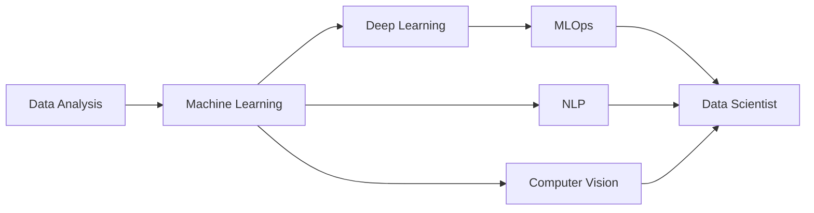

 

<!-- Animated Typing SVG (Dark & Light Mode Friendly) -->

  

<!-- Status Badges & Profile Views -->

  
  
  
  

 

<!-- Social Links -->

  
  
  

---

## 👨‍💻 About Me & Workspace

<!-- Tip: You can replace the image URL below with any custom GIF by dragging & dropping a .gif file directly into GitHub's README editor -->

 

---

## 🧰 Technical Stack & Icons

<!-- Modern Icon Grid -->

  

 

<!-- Categorized Data Science Badges -->

| Category | Technologies & Libraries |
| :--- | :--- |
| **Languages & Databases** |   |
| **Data Analysis & Viz** |      |
| **Tools & Environments** |    |

## 🌱 Learning Roadmap

---
**Current Focus:**
- ✅ Advanced Python & Statistics
- ✅ Machine Learning Fundamentals
- 🔄 Deep Learning with TensorFlow/PyTorch
- 🔄 Cloud Platforms (AWS/Azure)
- 📅 MLOps & Production Deployment
- 📅 Advanced NLP & Transformers

---

## 💡 Data Science Principles I Follow

> *"In Allah we trust, all others must bring data."* —

